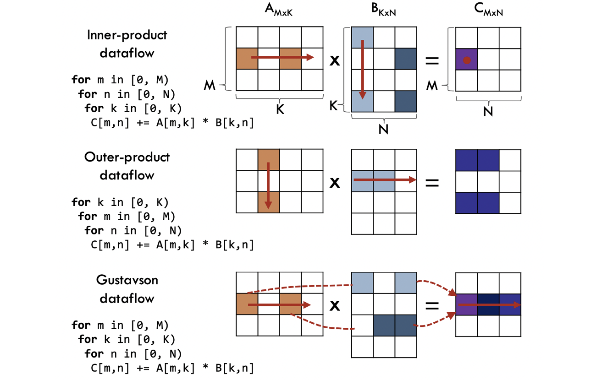

# ECE6750-PA3

## Setup 
```
ssh netid@login.ece.cornell.edu
git clone https://github.coecis.cornell.edu/ey273/ECE6750-PA3
cd ECE6750-PA3
gcc serial.c -o serial 
sbatch --partition=ece6750 run.sh
```

## Background 
In the previous two labs, you were introduced to the process of creating efficient matrix multiplication algorithms for dense matrices. The objective of this lab is to gain experience with sparse matrix multiplication, which is especially important in modern machine learning algorithms.

This lab begins with an introduction to the mechanics of working with sparse matrices, along with different approaches to sparse matrix multiplication. In the coding portion of the lab, you will be provided with a serial implementation of Gustavson’s algorithm, an efficient algorithm for sparse matrix multiplication. Your goal is to use the POSIX pthread library to parallelize this algorithm and develop a dynamic load-balancing solution.

### CSR, CSC, COO, and .mtx
A sparse matrix is a matrix that is primarily composed of zeros. Storing it as a dense matrix is therefore very inefficient. To address this issue, three formats have been developed for storing sparse matrices. Below is an example of a sparse matrix, along with explanations of how it would be stored in each of the three formats.


1. COO: Coordinate List. In this format, nonzero values (NNZs) are stored simply as a list of their coordinates and values using three arrays: row, which contains the row indices of the NNZs; column, which contains the column indices of the NNZs; and data, which contains the values of the NNZs. In this case:

- row: [0, 1, 2]
- column: [1, 0, 1]
- data: [1, 5, 9]

2. CSR: Compressed Sparse Row. In this format, the column and data arrays remain the same, storing the column indices and data values of the NNZs, respectively. However, instead of a row array, there is a pointer array that represents the cumulative number of NNZs encountered after each row. This pointer array always begins with 0. In this case,
   
- pointer: [0, 1, 2, 3]
- column: [1, 0, 1]
- data: [1, 5, 9]
  
The cumulative totals in the pointer array give it the property that ```pointer[i]``` represents where row i begins in the column and data arrays, while ```pointer[i+1]``` indicates where it ends. For instance, ```pointer[0] == 0``` and ```pointer[1] == 1```, indicating that there is one value in row 0, with a column index of ```column[0] == 1``` and a data value of ```data[0] == 1```.

3. CSC: Compressed Sparse Column. This format follows the same principle as CSR, except that the pointer array stores cumulative column totals rather than row totals. In this case,
- pointer: [0, 1, 2, 3]
- row: [0, 1, 2]
- data: [1, 5, 9]
  
Similarly, ```pointer[i]``` represents where column i begins in the row and data arrays, while ```pointer[i+1]``` represents where it ends.

The matrix files you will be given to multiply are in .mtx format. This file format is specifically designed for representing sparse matrices and stores them in COO format. .mtx files begin with metadata that describes properties of the matrix, such as symmetry.

The first non-metadata line of the file gives the dimensions of the matrix and the total number of NNZs. It is followed by a list of coordinates for all the NNZs in the matrix, along with their data values. This is given in the format:
```row column data```

**Note that .mtx files are 1-indexed, not 0-indexed.**

### Sparse MM Approaches
There are three main approaches to sparse matrix multiplication: the inner product, the outer product, and Gustavson’s algorithm. The chart below shows these three patterns:


Source: https://people.csail.mit.edu/sanchez/papers/2021.gamma.asplos.pdf 

This lab will focus on Gustavson’s algorithm, which is the most efficient of these algorithms in terms of both cache usage and performance on sparse matrices.

## Gustavson’s Algorithm

Gustavson’s algorithm is fairly complex to implement, so we have provided a serial implementation in ```serial.c```.

An overview of what you have been provided:
- ```CSRData``` and ```COOData```: Two structs that implement the CSR and COO storage formats for sparse matrices.
- ```resNNZCount```: A method for calculating the number of NNZs in the result matrix C for memory allocation.
- ```sparseMM```: A serial implementation of Gustavson’s algorithm.
- ```convert```: A method for converting a COO matrix read from a .mtx file into CSR format.
- ```main```: Provides functionality for reading .mtx files, timing your method, and printing both the elapsed time and the result matrix in COO format.

The basic premise of the algorithm is to traverse the rows of both the A and B matrices, a process made relatively simple when both matrices are in CSR format, and fill in the rows of the product matrix C. This should closely resemble the loop-switch procedure that you performed in Lab 0; in fact, the algorithm is almost exactly the same.

Look over the serial implementation and make sure you understand the algorithm, as the parallelization is nontrivial. It may help to review Lab 0 to recall how you implemented your loop switch.

For simplicity, all matrix multiplication operations in this lab will consist of squaring a sparse matrix. You may modify this for your own testing, but doing so will require editing the main method to read a second .mtx file.

Note that although both the A and B matrices are given in CSR format, the product matrix C is stored in COO format. It is not difficult to implement a serial version of Gustavson’s algorithm in which the product matrix C is also stored in CSR format. However, this makes parallelization tricky. Why might this be?

## Parallelization 
In the previous lab, you were introduced to parallelization with pthreads. In this lab, we will continue working with pthreads before moving on to a new, simpler parallelization model.

To evaluate your parallel algorithms, we will provide three matrices. The first, ```small.mtx```, is a small matrix intended to help you verify the correctness of your algorithms. The second, ```even.mtx```, is a large sparse matrix with NNZs evenly distributed across the matrix. The third, ```uneven.mtx```, is a large sparse matrix with an uneven distribution of NNZs.

### Pthread Parallelization 
Begin by converting the given serial algorithm into a parallel one using the pthread library. You should use the “naive” strategy of assigning alternating rows to threads. (A hint for later: Why might this not be the best strategy?)

Note that this parallelization is not straightforward, and you will need at least one mutex to avoid race conditions. Pay special attention to the result matrix, C. How is it stored? When is its state modified?

Verify the correctness of your parallel algorithm against the serial version using ```small.txt```. Then, record its performance on ```even.mtx``` and ```uneven.mtx```. You should notice that the algorithm performs significantly better on one of the two matrices. Why? Try printing how many operations each thread computes. What do you notice?

### OpenMP Parallelization 
The pthreads library gives you very fine-grained control over processes, and its lack of abstraction is useful for understanding how threads work. However, because of this same lack of abstraction, using pthreads in more complicated situations, such as those in this lab, becomes difficult.

For that reason, this lab introduces OpenMP, an API for shared-memory multithreading with a much higher level of abstraction. OpenMP allows you to parallelize programs declaratively, using compiler directives, instead of manually creating threads with pthreads.

OpenMP uses ```#pragma``` commands. These are declarative instructions to the compiler that provide additional information beyond what is included in the code itself, specifically describing how the programmer wants the code to be compiled. In the case of OpenMP, ```#pragma``` commands instruct the compiler to execute portions of the code in parallel, with various specifications. This eliminates the need for manual thread creation, as required with pthreads. In accordance with these ```#pragma``` instructions, the actual parallelization of the code is left to the compiler.

Note that ```#pragma``` directives are optional. Like the register keyword discussed in PA1, the compiler may choose to ignore ```#pragma``` directives that it does not recognize or cannot implement. Different compilers may also treat ```#pragma``` directives differently. In the case of OpenMP, ```#pragma``` directives are defined by the OpenMP standard and are understood by compilers that support OpenMP, including GCC, Clang, and Intel C++.

The simplest OpenMP directive is ```#pragma omp parallel```. This spawns a group of threads that execute part of your program in parallel. This directive is usually followed by a loop-parallelization directive such as ```#pragma omp for schedule(dynamic)```. When placed above a loop, this directive initiates parallelization of the loop using the specified schedule. There are four different schedules that can be used: static, dynamic, guided, and auto.
- ```static```: Divides work into chunks of a given size and assigns those chunks among the threads. If no chunk size is given, the work is divided evenly among the threads.
- ```dynamic```: Threads request chunks at runtime as they finish work.
- ```guided```: Similar to dynamic, except the chunk size decreases exponentially over time.
- ```auto```: Leaves the scheduling choice to the compiler.

You will also likely need the directive ```#pragma omp critical```. This instructs the compiler that the following lines of code should be executed by only one thread at a time.

Using OpenMP, parallelize the given serial version of Gustavson’s algorithm. You should experiment with the dynamic and guided schedulers. Evaluate your algorithm’s performance on both ```even.mtx``` and ```uneven.mtx```. How does it compare to your pthread-parallelized version?

### Non-zero Partitioning for Load Balancing
While your pthread algorithm assigns work statically by dividing rows evenly among threads, and your OpenMP algorithm assigns work dynamically, there is also a third way to assign work to threads: based on the number of calculations per row.

**Computing Calculations Per Row**

Looking back at Gustavson’s algorithm, we can see that for each row r in matrix A, we scale row i in matrix B by element i of r. Using this fact, write a method that takes the CSR matrices A and B and returns a list containing the number of operations for each row of A.

**Assigning Works to Threads**

Now that you have calculated the number of operations per row, you will need to determine which rows to assign to each thread. As a starting point, here are some hints:
- Your goal should be to assign a roughly equal number of calculations to each thread.
- A prefix sum will be useful.
- You will need to implement a binary search.
  
Once you have developed a functional nonzero partitioning algorithm, evaluate it on ```even.mtx``` and ```uneven.mtx```. How does it compare to the other two algorithms?

## Submission 

Your submission should include your pthread-parallelized algorithm, your OpenMP-parallelized algorithm, evaluation times for ```even.mtx``` and ```uneven.mtx```, and responses to the following questions:
1. What are the hardware benefits of storing sparse matrices in CSR or COO format instead of in dense formats?
2. Why is Gustavson’s algorithm more efficient than the inner product or outer product approaches?
3. Include both hardware (i.e., cache) and algorithmic considerations.
4. Why would parallelizing a version of Gustavson’s algorithm in which the output matrix is stored in CSR format be inefficient and more difficult?
5. How did your pthread-parallelized algorithm compare to the OpenMP-parallelized version on ```even.mtx```? Why might it have performed better?
6. How did your pthread-parallelized algorithm compare to the OpenMP version on ```uneven.mtx```? Why did it perform worse?
7. How did your nonzero-partitioning, load-balanced algorithm compare to the OpenMP and pthread versions? What are the benefits and drawbacks of this algorithm compared to your OpenMP version? Include considerations for both ```even.mtx``` and ```uneven.mtx```.

You must include the following two sections:
1. Who Did What: Describe how each team member contributed to the submission, in detail. Plan to document this from the start of the project.
2. GenAI usage: Explain whether and how you used generative AI. It's very important that you go over the academic integrity section in the course description. If you have any doubts as to what is and isn't allowed, ask. A good rule of thumb is: Everything you submit should be your own work; treat genAI as a fallible TA rather than a teammate or reliable source.
